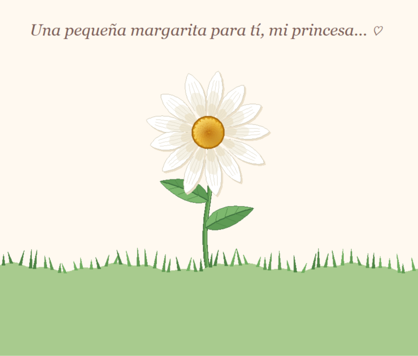

# 🌼 A Daisy for My Princess

*A little flower, a little game, and a thousand ways to say I love you.*

This project is an interactive Python animation created with Turtle Graphics.

It tells the story of a little daisy that gradually comes to life: its stem grows, its leaves unfold, and its thirteen petals appear one by one.

But the flower has a little surprise...

Once fully bloomed, the petals begin to fall, following the classic "He loves me, he loves me not" game.

And at the end, a very special birthday message is waiting.

**Made with love for Val, my princess. ♡**

---

## 💗 Graphical Representation

### The final result



### 🎬 Animation preview

Watch the daisy grow, bloom, and tell its little story:

[▶ Watch the animation — margarita.mp4](graphical-representation/margarita.mp4)

---

## ✨ About the project

The animation combines mathematical geometry, procedural drawing, and timed events to recreate a stylized daisy.

Each flower component is generated through custom geometric functions, including elongated petals, detailed veins, a seed-filled center, curved leaves, and a naturally shaped stem.

Once the flower is fully assembled, a sequence of falling petals recreates the traditional "He loves me, he loves me not" game.

The animation concludes with personalized romantic and birthday messages.

### Features

- 🌼 Procedural flower generation using mathematical geometry.
- 🌱 Progressive stem growth animation.
- 🍃 Animated leaf growth with custom shapes and veins.
- 🌸 Thirteen individually generated petals.
- 🌻 Detailed flower center with 140 seeds arranged using the golden angle.
- 🎨 Custom color interpolation and shading.
- 🍂 Individual petal falling animations with rotation and movement.
- 💌 Interactive-style "He loves me, he loves me not" sequence.
- 🎂 Personalized birthday messages.
- 💗 A little digital flower created especially for Val.

---

## 🛠️ Built with

- **Python 3**
- **Turtle Graphics** — Drawing and animation rendering.
- **Math** — Trigonometric functions, geometric transformations, and mathematical curves.
- **Random** — Natural-looking variations in petals, positions, and grass.
- **Tkinter** — Window management and timed animation events through Turtle.

---

## 📂 Project structure

```text
a-daisy-for-my-princess/
│
├── main.py
├── README.md
│
└── graphical-representation/
    ├── margarita.png
    └── margarita.mp4
```

| File | Description |
|---|---|
| `main.py` | Main script responsible for generating the flower and its animation sequence. |
| `graphical-representation/margarita.png` | Screenshot of the completed daisy illustration. |
| `graphical-representation/margarita.mp4` | Video showing the complete animation. |
| `README.md` | Project documentation. |

---

## 🚀 Getting started

### Requirements

- Python 3.x
- Tkinter support for Python Turtle.

### Installation

Clone the repository:

```bash
git clone https://github.com/laetg404/a-daisy-for-my-princess.git
```

Navigate to the project directory:

```bash
cd a-daisy-for-my-princess
```

Run the script:

```bash
python main.py
```

---

## ⚙️ How it works

1. Initializes the Turtle graphics environment and configures the animation canvas.
2. Generates thirteen petals with randomized dimensions and orientations.
3. Constructs each petal using mathematical profiles, shading layers, and decorative veins.
4. Generates the flower center using 140 seeds distributed according to the golden angle.
5. Creates the stem, leaves, and grass using geometric functions.
6. Animates the stem growing from the ground.
7. Gradually reveals the leaves and individual petals.
8. Displays the completed flower and a personalized message.
9. Animates each petal falling with rotation, acceleration, and a subtle swaying effect.
10. Alternates between "He loves me..." and "He loves me not..." as the petals fall.
11. Reveals the final romantic and birthday messages.

---

## ♡ A little dedication

Thirteen little petals, one beautiful flower, and a little game that ends with the answer I already know.

If every petal had a chance to tell me whether you love me, I would still choose you every single time.

Because I don't need a flower to know how much you mean to me.

**Happy birthday, my love. Every day, I celebrate the beautiful fact that you exist.**

**For Val, my princess. Always. ♡**

---

<sub>Part of a collection of little projects created with love.</sub>

🌼
